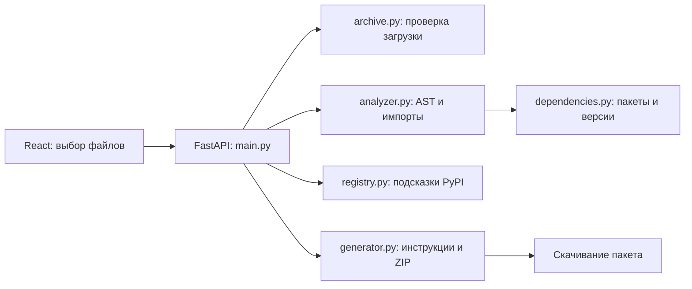

# Перенос

Упаковщик Python-проектов для запуска на другом компьютере. Пользователь загружает исходники и данные, проверяет найденные зависимости и скачивает ZIP с проектом, requirements.txt, README и отчётом.

Проект сделан по кейсу «Повтори мой эксперимент: упаковщик научного кода». Основная задача — помочь другому человеку установить зависимости и повторить запуск. Анализ выполняется без импорта и запуска загруженных Python-файлов.

Этот README описывает **сам сервис «Перенос»**: установку, устройство кода и демонстрацию на защите. Внутри скачиваемого пакета создаётся другой README — инструкция для загруженного пользователем проекта.

## Содержание

- [Что делает сервис](#что-делает-сервис)
- [Запуск самого сайта](#запуск-самого-сайта)
- [Как пользоваться сайтом](#как-пользоваться-сайтом)
- [Что находится в полученном ZIP](#что-находится-в-полученном-zip)
- [Устройство проекта и назначение файлов](#устройство-проекта-и-назначение-файлов)
- [Как проходит один запрос](#как-проходит-один-запрос)
- [Как определяются зависимости и версии](#как-определяются-зависимости-и-версии)
- [Безопасность и ограничения](#безопасность-и-ограничения)
- [API](#api)
- [Тесты и проверка примеров](#тесты-и-проверка-примеров)
- [Демонстрация на защите](#демонстрация-на-защите)
- [Соответствие ТЗ](#соответствие-тз)
- [Вопросы на защите](#вопросы-на-защите)
- [Если что-то не запускается](#если-что-то-не-запускается)

## Что делает сервис

На вход принимаются один или несколько `.py`, обычная папка либо ZIP/RAR с Python-кодом. Вместе с кодом можно передать CSV, текстовые файлы, изображения и другие данные проекта.

Сервис:

1. Проверяет загрузку и показывает дерево файлов.
2. Разбирает Python-код через AST, находит импорты и возможные команды запуска.
3. Разделяет стандартные, локальные, внешние и неизвестные зависимости.
4. Читает файлы зависимостей и сохранённые версии.
5. Предлагает уточнить неизвестные пакеты и проверить команду запуска.
6. Создаёт ZIP с исходниками, данными и инструкциями.

Для каждой зависимости сохраняется основание решения: импорт из конкретного файла и строки, запись в файле зависимостей либо сведения из отчёта среды.

Статический анализ не гарантирует запуск произвольного проекта. Недостающие данные, динамические импорты, системные библиотеки и настройки могут потребовать ручной проверки. Эти случаи отражаются в интерфейсе и REPORT.md.

## Запуск самого сайта

### Что нужно установить

| Инструмент | Для чего нужен |
| --- | --- |
| Python 3.12+ | Запуск FastAPI и анализатора |
| Node.js 22.12+ и npm | Установка и сборка React-интерфейса |
| Git | Получение проекта через `git clone` |
| Firefox или другой современный браузер | Работа с сайтом |

Приложение проверено на Python 3.14.6. Конкретные версии Python-зависимостей перечислены в [backend/requirements.txt](backend/requirements.txt), версии фронтенда зафиксированы в [frontend/package-lock.json](frontend/package-lock.json).

Docker, Conda и uv для обычного запуска сервиса не нужны. Файлы этих инструментов сервис умеет читать или создавать.

### macOS и Linux: первая установка

Выполните в терминале:

```bash
git clone https://github.com/apvpw/project.git
cd project

python3 -m venv .venv
source .venv/bin/activate

python -m pip install -r backend/requirements.txt
npm --prefix frontend ci
npm --prefix frontend run build

python run.py
```

Если репозиторий уже скачан, откройте его корневую папку в VS Code и начните с создания `.venv`. В этой папке должны находиться `README.md`, `run.py`, `backend/` и `frontend/`.

Откройте **http://127.0.0.1:8000**. Терминал с сервером оставьте открытым. Остановка — `Ctrl+C`.

### Windows PowerShell: первая установка

```powershell
git clone https://github.com/apvpw/project.git
cd project

py -m venv .venv
.\.venv\Scripts\Activate.ps1

python -m pip install -r backend/requirements.txt
npm --prefix frontend ci
npm --prefix frontend run build

python run.py
```

Если используется команда `python` вместо `py`, замените только команду создания окружения. При запрете активации PowerShell можно обращаться к `.\.venv\Scripts\python.exe` напрямую.

### Повторный запуск

Зависимости устанавливаются при подготовке окружения. Для следующего запуска на macOS/Linux достаточно:

```bash
source .venv/bin/activate
python run.py
```

Скрипт `run.py` запускает Uvicorn на `127.0.0.1:8000`. FastAPI обслуживает API и готовую сборку интерфейса из `frontend/dist`.

Для сжатых RAR дополнительно нужен распаковщик в PATH: `unrar`, `unar`, 7-Zip или `bsdtar`. Например, `brew install unar` на macOS или `sudo apt install unar` на Ubuntu. Для ZIP и выбора папки этот инструмент не нужен.

### Разработка с обновлением интерфейса

В первом терминале, из корня репозитория:

```bash
source .venv/bin/activate
python -m uvicorn backend.main:app --reload --host 127.0.0.1 --port 8000
```

Во втором:

```bash
npm --prefix frontend run dev
```

Откройте адрес, который напечатал Vite, обычно **http://127.0.0.1:5173**. Vite отправляет запросы `/api` на FastAPI через proxy из `frontend/vite.config.js`.

Для запуска через `python run.py` изменения фронтенда нужно собрать командой `npm --prefix frontend run build`. Live Server не обрабатывает JSX и не запускает Python-сервер.

## Как пользоваться сайтом

### 1. Загрузка

Нажмите **«Выбрать проект»**. В меню доступны файлы/архив и выбор папки. Два варианта нужны из-за отдельных системных диалогов выбора файлов и каталогов в браузере.

Загрузите Python-код вместе с локальными модулями и примером данных. После проверки появится дерево файлов. Затем нажмите **«Проверить зависимости»**.

Папки `.git`, `.venv`, `venv`, `node_modules`, `__pycache__`, `__MACOSX` и `.pytest_cache` пропускаются. Окружение автора не нужно упаковывать в архив.

### 2. Проверка зависимостей

В таблице показаны:

| Тип | Пример | Что попадёт в requirements |
| --- | --- | --- |
| Стандартный модуль | `pathlib`, `re`, `collections` | Ничего: модуль входит в Python |
| Локальный модуль | `helpers.py` рядом с основным файлом | Ничего: файл переносится вместе с проектом |
| Внешний пакет | `numpy`, `pandas` | Имя пакета и найденное ограничение версии |
| Неизвестная зависимость | Импорт без надёжного соответствия пакету | Только подтверждённый пользователем пакет |

Нажатие на импорт раскрывает источник решения и места использования. Доступны поиск и фильтры.

Для неизвестных имён сервис запрашивает сведения в PyPI. Совпадение имени — подсказка, поэтому пользователь подтверждает найденный пакет. Название дистрибутива может отличаться от импорта: например, `PIL → Pillow` и `sklearn → scikit-learn`.

Если пакет или версия известны автору, их можно вписать вручную. Запись `2.2.3` при сборке нормализуется в `==2.2.3`; ограничения вроде `>=2,<3` также поддерживаются.

### 3. Скачивание

Нажмите **«К скачиванию»**, проверьте предложенную команду запуска и состав архива. При необходимости включите Dockerfile в разделе «Дополнительно».

Нажмите **«Скачать ZIP»**. После распаковки выполните команды из README полученного проекта.

Шкала сверху показывает завершённые этапы подготовки пакета. Все три завершённых этапа означают, что пакет сформирован для скачивания. Они не подтверждают успешный запуск проекта: его проверяют отдельно.

### Необязательный отчёт среды автора

Если проект уже работает на компьютере автора, можно передать версии его окружения. На первом экране раскройте **«Версии среды»**, скачайте скрипт и выполните его в том Python-окружении, где работает исходный проект:

```bash
python environment_report.py
```

Либо используйте скрипт из репозитория:

```bash
python tools/environment_report.py
```

Появится `environment-report.json`. Его можно проверить как обычный текст и приложить к загрузке через поле отчёта среды.

Скрипт читает версию Python, названия и версии установленных пакетов, а также соответствия импортов из их метаданных. Он не запускает исходники проекта, не собирает значения переменных окружения и ничего не отправляет по сети.

Версии применяются к найденным зависимостям, если они не конфликтуют с файлами проекта. Сам JSON не доказывает совместимость программы с этой средой.

## Что находится в полученном ZIP

Пример результата для проекта с анализом CSV:

```text
project/
├── main.py
├── sales.csv
├── pyproject.toml
├── uv.lock
├── README.md
├── requirements.txt
├── REPORT.md
└── Dockerfile          # Если включён пользователем
```

| Файл | Назначение |
| --- | --- |
| Исходники и данные | Переданные пользователем файлы; содержимое сохраняется, кроме выбранных исключений |
| `README.md` | Создание venv, установка зависимостей, команда запуска, дерево файлов и необходимые уточнения |
| `requirements.txt` | Только строки пакетов для pip, без поясняющих комментариев |
| `REPORT.md` | Основания выбора зависимостей, предупреждения, неопределённости и форма проверки запуска |
| `Dockerfile` | Необязательный начальный шаблон контейнера для загруженного проекта |

Если в исходном проекте уже есть README, requirements, REPORT или включённый при сборке Dockerfile, прежние файлы сохраняются в `originals/`. Если имя занято, выбирается `originals-2/` и далее. В новом README указаны перемещения.

Одна общая внешняя папка архива убирается. Внутренняя структура проекта сохраняется. Файлы с признаками секретов по умолчанию исключаются, их имена перечисляются в отчёте.

Для проекта без внешних библиотек `requirements.txt` будет пустым. Это допустимый файл: pip ничего не установит. Если пакет не удалось определить, он не записывается в requirements наугад; уточнение остаётся в интерфейсе, README и REPORT.

## Устройство проекта и назначение файлов

В проекте два приложения: React отвечает за интерфейс, FastAPI — за обработку загрузки. Алгоритмы вынесены в обычные Python-модули по их назначению. Базы данных, очереди задач и отдельного сервиса выполнения кода нет.

### Почему выбраны эти библиотеки

| Инструмент | Задача в проекте |
| --- | --- |
| React | Состояние интерфейса и переиспользуемые части трёх экранов |
| Vite | Запуск интерфейса при разработке и сборка HTML/CSS/JavaScript для раздачи FastAPI |
| FastAPI | HTTP API, приём файлов и ответы в JSON или ZIP |
| Uvicorn | ASGI-сервер, который запускает FastAPI и принимает HTTP-соединения |
| Pydantic | Проверка структуры запросов и представление результатов анализа |
| python-multipart | Чтение загрузок файлов через multipart/form-data |
| ast | Синтаксический разбор Python; входит в стандартную библиотеку |
| pathlib | Работа с путями; входит в стандартную библиотеку |
| zipfile и io.BytesIO | Чтение и создание ZIP в памяти; входят в стандартную библиотеку |
| tomllib и PyYAML | Чтение TOML и YAML; tomllib входит в Python, PyYAML устанавливается через pip |
| packaging | Разбор имён пакетов, extras, маркеров и ограничений версий |
| httpx | Запросы метаданных PyPI; также используется тестовым HTTP-клиентом |
| rarfile | Чтение структуры RAR и работа с внешним распаковщиком |

### Структура каталогов

```text
project/
├── backend/
│   ├── main.py
│   ├── archive.py
│   ├── analyzer.py
│   ├── dependencies.py
│   ├── registry.py
│   ├── generator.py
│   ├── models.py
│   └── requirements.txt
├── frontend/
│   ├── src/
│   │   ├── main.jsx
│   │   ├── App.jsx
│   │   ├── api.js
│   │   ├── styles.css
│   │   └── components/
│   │       ├── UploadPanel.jsx
│   │       ├── Dependencies.jsx
│   │       ├── PackagePanel.jsx
│   │       └── FileTree.jsx
│   ├── public/favicon.svg
│   ├── index.html
│   ├── package.json
│   ├── package-lock.json
│   └── vite.config.js
├── examples/
│   ├── archives/
│   │   ├── data_analysis.zip
│   │   └── local_modules.zip
│   ├── data_analysis/
│   │   ├── main.py
│   │   ├── sales.csv
│   │   ├── pyproject.toml
│   │   └── uv.lock
│   └── local_modules/
│       ├── main.py
│       ├── helpers.py
│       └── sample.txt
├── tests/
│   ├── test_project.py
│   ├── verify_examples.py
│   ├── VERIFICATION.md
│   └── requirements.txt
├── tools/environment_report.py
├── run.py
├── .gitignore
└── README.md
```

### Бэкенд

| Файл | Что делает | Основные функции |
| --- | --- | --- |
| [main.py](backend/main.py) | Принимает HTTP-запросы, читает загрузку, хранит временные сессии, вызывает анализатор и генератор, возвращает ZIP. Также раздаёт собранный фронтенд | `read_project`, `analyze_upload`, `preview`, `package`, `cleanup` |
| [archive.py](backend/archive.py) | Проверяет имена, размеры, типы файлов и структуру архива. Возвращает словарь `путь → байты` и список пропущенных файлов | `safe_name`, `read_uploads`, `rar_entries`, `decode_python` |
| [analyzer.py](backend/analyzer.py) | Обходит AST, собирает импорты, различает локальные и стандартные модули, ищет точки запуска и признаки проблем | `analyze`, `analyze_source`, `local_module`, `inspect_call`, `secret_files` |
| [dependencies.py](backend/dependencies.py) | Сопоставляет модули пакетам, читает файлы зависимостей, применяет сохранённые версии и проверяет их соответствие ограничениям | `known_package`, `read_manifests`, `read_locked_versions`, `apply_recorded_versions`, `requirement_parts` |
| [registry.py](backend/registry.py) | Получает подсказки из PyPI по неизвестным импортам. Ограничивает время, число запросов и размер ответа; кеширует результат | `query_package`, `search_unknowns` |
| [generator.py](backend/generator.py) | Проверяет пользовательские уточнения, создаёт README/requirements/REPORT/Dockerfile, рассчитывает пути оригиналов и собирает ZIP | `prepare_options`, `generate`, `requirements_text`, `report_text`, `build_zip` |
| [models.py](backend/models.py) | Описывает структуру результатов и запросов с помощью Pydantic; проверяет допустимые значения входных данных | `Dependency`, `Analysis`, `PackageRequest` и остальные модели |
| [requirements.txt](backend/requirements.txt) | Python-библиотеки, необходимые для запуска самого сервиса | Устанавливаются через `pip install -r backend/requirements.txt` |

В `analyzer.py` принимаются решения об импортируемых модулях. В `dependencies.py` сосредоточены сведения о пакетах и версиях. В `generator.py` формируется результат. Такой разбор позволяет менять формат отчёта, не переписывая обход Python-кода.

### Модели данных

| Модель | Что хранит |
| --- | --- |
| `Evidence` | Файл, строку и описание основания: например, `main.py:5 — import numpy` |
| `Dependency` | Импорт, его тип, пакет для установки, версию, источник решения и список оснований |
| `Warning` | Код замечания, текст, файл, строку и уровень `info / warning / danger` |
| `EntryPoint` | Возможную команду запуска и объяснение, откуда она взята |
| `Analysis` | Полный результат: файлы, зависимости, предупреждения, команды запуска, требования к Python и найденный стек |
| `PackageOptions` | Уточнённые зависимости, команду, версию Python для Docker, настройки Docker и исключения секретов |
| `PackageRequest` | Настройки сборки вместе с идентификатором ранее проанализированной загрузки |

Тип зависимости принимает одно из четырёх значений: `standard`, `local`, `external`, `unknown`.

### Фронтенд

| Файл | Что делает |
| --- | --- |
| [main.jsx](frontend/src/main.jsx) | Подключает шрифт и CSS, монтирует React-приложение в элемент `root` |
| [App.jsx](frontend/src/App.jsx) | Хранит общие состояния: выбранные файлы, анализ, зависимости и настройки. Переключает три этапа, считает прогресс и открывает справку |
| [api.js](frontend/src/api.js) | Выполняет `fetch`-запросы, собирает `FormData` для файлов, обрабатывает ошибки и скачивает ZIP через `Blob` |
| [UploadPanel.jsx](frontend/src/components/UploadPanel.jsx) | Выбор файлов/папки, перетаскивание файлов, предварительные ограничения и запрос дерева через `/api/inspect` |
| [Dependencies.jsx](frontend/src/components/Dependencies.jsx) | Таблица импортов, фильтры, поиск, раскрытие оснований, ручное уточнение пакетов и версий, показ предупреждений |
| [PackagePanel.jsx](frontend/src/components/PackagePanel.jsx) | Команда запуска, Docker и исключение секретов, предпросмотр файлов, дерево итогового архива и кнопка скачивания |
| [FileTree.jsx](frontend/src/components/FileTree.jsx) | Преобразует список путей в дерево и рекурсивно отображает папки и файлы. Помечает добавленные генератором файлы |
| [styles.css](frontend/src/styles.css) | Цвета, типографика, сетка, таблицы, состояния элементов, мобильная версия и учёт уменьшенного движения |
| [index.html](frontend/index.html) | HTML-страница с контейнером `root` и точкой входа `src/main.jsx` |
| [favicon.svg](frontend/public/favicon.svg) | Значок вкладки браузера |
| [package.json](frontend/package.json) | React, Vite, шрифт, команды `dev`, `build` и `preview` |
| [package-lock.json](frontend/package-lock.json) | Зафиксированное дерево npm-зависимостей для повторяемой установки через `npm ci` |
| [vite.config.js](frontend/vite.config.js) | Подключение React к Vite и proxy запросов `/api` во время разработки |

Компоненты получают данные и обработчики из `App.jsx`. Например, изменение версии в `Dependencies` обновляет общий список зависимостей, который затем получает `PackagePanel`.

Предпросмотр пересоздаётся после изменения настроек с небольшой задержкой, чтобы не отправлять запрос на каждый введённый символ. После изменения настроек ранее скачанный ZIP больше не считается актуальным для этих настроек.

### Остальные файлы

| Файл или папка | Назначение |
| --- | --- |
| [run.py](run.py) | Проверяет наличие собранного интерфейса и запускает сайт через Uvicorn |
| [tools/environment_report.py](tools/environment_report.py) | Добровольный сбор метаданных среды автором исходного проекта |
| [tests/test_project.py](tests/test_project.py) | Автоматические проверки анализа, архивов, PyPI-подсказок, генерации и API |
| [tests/verify_examples.py](tests/verify_examples.py) | Получает пакеты двух подготовленных примеров через API, устанавливает их зависимости в новые venv и запускает эти примеры |
| [tests/VERIFICATION.md](tests/VERIFICATION.md) | Записанный результат проверки: окружение, полученный requirements, команды, вывод и установленные версии |
| [tests/requirements.txt](tests/requirements.txt) | Зависимость HTTP-клиента для тестов. Это не список библиотек сайта или загруженного проекта |
| [examples/archives](examples/archives) | Два готовых входных ZIP для демонстрации |
| [examples/data_analysis](examples/data_analysis) | `main.py` читает `sales.csv` с numpy/pandas; `pyproject.toml` задаёт требования, `uv.lock` содержит точные версии |
| [examples/local_modules](examples/local_modules) | `main.py` читает `sample.txt`; `helpers.py` считает слова через стандартные `re` и `collections` |
| [.gitignore](.gitignore) | Исключает окружения, сборку, кеши, временные файлы проверок, `.env`-файлы и отчёт локальной среды из Git |

`.venv/`, `frontend/node_modules/` и `frontend/dist/` создаются локально при установке и сборке. На GitHub они не публикуются.

## Как проходит один запрос

Общая схема:



Последовательность при обычном использовании:

1. **Выбор файлов.** `UploadPanel` передаёт их в `api.js`. Он собирает multipart-запрос с файлами и относительными путями.
2. **Предварительная проверка.** `POST /api/inspect` вызывает `read_project → read_uploads` и возвращает список путей. `FileTree` строит дерево. На этом шаге сессия проекта ещё не создаётся.
3. **Анализ.** `POST /api/analyze` повторно принимает загрузку, проверяет её и вызывает `analyze`. Обработка выполняется в рабочем потоке, а не через исполнение пользовательского кода.
4. **Сохранение результата.** Бэкенд создаёт случайный идентификатор и временно сохраняет исходники и объект `Analysis` в памяти. Фронтенд получает результат в JSON.
5. **Уточнение.** Отдельный запрос получает PyPI-подсказки. Пользователь меняет пакеты, версии и команду; эти правки хранятся в React-состоянии.
6. **Предпросмотр.** `POST /api/preview` передаёт идентификатор и настройки. Генератор проверяет правки, создаёт тексты файлов и точный список содержимого будущего ZIP.
7. **Сборка.** `POST /api/package` с теми же настройками повторяет генерацию и вызывает `build_zip`. Ответ — байты архива с типом `application/zip`.
8. **Скачивание.** `api.js` получает ответ как `Blob` и инициирует скачивание `python-reproducibility.zip`.

При сборке стандартные и локальные зависимости берутся из исходного результата анализа. Клиент не может произвольно подменить их тип, источник или список импортов: сервер проверяет структуру запроса.

## Как определяются зависимости и версии

### Разбор импортов

`ast.parse` превращает исходный текст в синтаксическое дерево. `ast.walk` обходит его узлы. Для `import` используются узлы `ast.Import`, для `from ... import ...` — `ast.ImportFrom`.

Например:

```python
from pathlib import Path
import numpy as np
from helpers import count_words
```

Результат:

- `pathlib` — стандартная библиотека;
- `numpy` — внешний пакет numpy;
- `helpers` — локальный модуль, если соответствующий файл есть в загрузке.

Учитываются относительные импорты, обычные пакеты и структура `src/`. Если один импорт разрешается по-разному в разных частях проекта, он остаётся неоднозначным.

Стандартные имена проверяются по каталогу Python, на котором работает анализатор. Локальный файл вроде `logging.py` может перекрывать стандартный модуль; такие случаи требуют проверки пути запуска.

Импорты внутри `try` и `TYPE_CHECKING` также видны в общем списке. Анализатор предупреждает, что они могут быть необязательными или нужны только проверке типов.

### Соответствие модуля пакету

Используются явные зависимости проекта, каталог известных соответствий, сведения из отчёта автора и имена в lock-файлах. Для составных пространств имён учитываются известные префиксы, например разные пакеты `google.cloud`.

Неизвестное внешнее имя можно проверить в PyPI. Проверка существования дистрибутива не доказывает, что именно он предоставляет импорт, поэтому найденная подсказка требует подтверждения.

Если остаётся несколько подходящих пакетов или не найден локальный относительный импорт, сервис не выбирает пакет автоматически.

### Файлы зависимостей

| Источник | Что учитывается |
| --- | --- |
| `requirements.txt`, `requirements.in` | Имена, ограничения версий, extras, маркеры и доступные подключения через `-r` |
| `requirements-dev.txt` и похожие файлы, `requirements/*.txt` | Дополнительные зависимости; в итог включаются найденные используемые пакеты |
| `pyproject.toml` | Стандартные `[project]`, `requires-python`, основные и дополнительные зависимости, `dependency-groups` |
| `environment.yml` / `environment.yaml` | Conda-зависимости и отдельная группа `pip` |
| `uv.lock`, `poetry.lock`, `pdm.lock`, `Pipfile.lock` | Точные версии уже найденных пакетов, если выбор однозначен и совместим с требованиями |
| Отчёт среды автора | Установленные версии и соответствия импортов дистрибутивам из метаданных |

Основные заявленные зависимости сохраняются, даже если прямой импорт не найден. Это важно для пакетов, которые запускаются отдельной командой или подключаются косвенно. Из дополнительных групп берутся пакеты с найденными импортами, чтобы не переносить все инструменты разработки.

Conda-пакет не считается автоматически одноимённым пакетом pip. Исходный YAML сохраняется, а README содержит отдельные указания для Conda.

Чтение lock-файла не является его полным экспортом: хеши, весь граф транзитивных зависимостей и условия установки не воспроизводятся в новом requirements. Оригинальный lock-файл остаётся в пакете. Git-зависимости, локальные пути и отдельные источники требуют ручной настройки.

Нестандартные зависимости старого раздела Poetry, вычисляемые метаданные и зависимости, создаваемые через выполнение `setup.py`, полностью не восстанавливаются. Сервис не запускает сборку исходного проекта.

### Откуда берётся версия библиотеки

1. Сохраняется ограничение из файла зависимостей проекта.
2. Если в lock-файле найдена одна подходящая версия, ограничение уточняется до неё.
3. Если lock-версии нет, используется совместимая версия из переданного отчёта среды автора.
4. При конфликте или нескольких вариантах появляется предупреждение; несовместимая версия не подставляется вместо требования проекта.
5. Если сведений нет, пакет записывается без закреплённой версии.

Пример исходного ограничения:

```toml
dependencies = ["numpy>=2.5,<3"]
```

Если в загруженном `uv.lock` указана подходящая версия `2.5.4`, результат:

```text
numpy==2.5.4
```

Из строки `import numpy` нельзя узнать, использовал автор numpy 1.x или 2.x. Подстановка последнего релиза из PyPI не восстановила бы исходную среду. Если версия не задана, pip выбирает подходящую доступную версию во время установки.

Вложенные зависимости устанавливает pip. Например, вместе с pandas могут установиться библиотеки, которых нет в прямых импортах исходного скрипта.

### Версия Python, стек и команда запуска

Требование к Python читается из `pyproject.toml` и поддерживаемой записи Python в Conda-файле. Дополнительно проверяются несколько конструкций синтаксиса:

| Конструкция | Вывод анализатора |
| --- | --- |
| `match/case` | Нужен Python не ниже 3.10 |
| `except*` | Нужен Python не ниже 3.11 |
| Параметры типов и оператор `type` | Нужен Python не ниже 3.12 |

Это неполная нижняя граница, а не точная версия и не проверка всех используемых API.

Стек определяется по известным библиотекам. Команда запуска предлагается по блоку `if __name__ == "__main__"`, созданию FastAPI/Flask-приложения либо характерному имени файла. Для пакетной структуры предлагается запуск через `python -m`. Пользователь проверяет путь, аргументы и дополнительные настройки.

### Неопределённости

В REPORT и интерфейсе отражаются динамические импорты, обращения к некоторым отсутствующим файлам и сетевым данным, чтение переменных окружения, проблемы синтаксиса, отсутствие README/LICENSE, признаки секретов и неизвестные версии.

Эти проверки основаны на распознаваемых конструкциях. Анализатор не вычисляет произвольные выражения и не отслеживает все возможные пути выполнения.

## Безопасность и ограничения

### Выполнение кода и хранение

Во время анализа загруженные `.py` не импортируются, не выполняются через `exec/eval` и не запускаются отдельным Python-процессом. Команда запуска проверяется и записывается в инструкции. Сервис не выполняет её.

Исходники, результаты и идентификаторы загрузок хранятся в памяти одного процесса. База данных и постоянная история загрузок не используются. Время доступности сессии — 30 минут с момента анализа; фон удаляет просроченные сессии раз в минуту, срок дополнительно проверяется при обращениях. Перезапуск сервера очищает сессии. Кнопка «Новый проект» удаляет текущую сессию.

Обработка multipart-загрузок и внешний распаковщик RAR могут использовать системные временные файлы. Отсутствие базы данных не означает запрета временной записи во всех используемых библиотеках.

### Проверка архивов и файлов

| Ограничение | Значение |
| --- | --- |
| Общий размер загружаемых файлов | До 20 МБ |
| Тело HTTP-запроса с multipart-обвязкой | До 22 МБ |
| Один файл | До 5 МБ |
| Суммарно после распаковки | До 50 МБ |
| Принятые файлы в архиве | До 500 |
| Выбор обычных файлов или папки | До 100 файлов после клиентского пропуска служебных папок |
| Отчёт среды | До 1 МБ |
| Одновременно хранимые проекты | До 8 на процесс |
| Python-файл для AST-разбора | До 1 МБ; более крупный сохраняется с предупреждением |

Проверяются абсолютные пути, `..`, обратные слеши, управляющие символы, ссылки и специальные файлы, повторяющиеся имена и конфликты «файл/папка». Для архива дополнительно ограничивается количество записей, включая каталоги. Архивы с паролем и многотомные RAR отклоняются.

В загрузке нужен хотя бы один читаемый текстовый `.py`. Переименование музыки в `.py` не делает её допустимым исходником. Синтаксически сломанный файл можно передать: он сохранится, а ошибка попадёт в отчёт. Изображения и аудио внутри Python-проекта сохраняются как данные.

### Секреты и внешние запросы

По именам файлов и характерным текстовым признакам ищутся `.env`, приватные ключи и некоторые токены/пароли. Подозрительные файлы по умолчанию исключаются из ZIP. Если они нужны программе, настройки придётся восстановить вручную. Пользователь может изменить это решение перед скачиванием.

В PyPI отправляются названия неизвестных импортов; исходный код туда не отправляется. Неизвестные импорты из файлов с обнаруженными признаками секретов не проверяются через PyPI. Значения обнаруженных секретов не включаются в предупреждения.

За один анализ проверяются до 30 имён. Общий поиск ограничен пятью секундами, результаты существования/отсутствия пакета кешируются на час. Пакеты не скачиваются и не устанавливаются сервером. Без доступа к PyPI локальный анализ продолжает работать.

Проверка секретов эвристическая: она не гарантирует, что найдены все приватные значения. Статический разбор также не является заключением о безопасности программы.

### Границы текущей версии

Приложение рассчитано на небольшие проекты и локальную демонстрацию. Нет регистрации, очереди выполнения, распределённых сессий и облачной CI/CD. Сервер запускается в одном процессе: несколько независимых workers не будут разделять словарь загрузок.

Сервис не подготавливает автоматически системные драйверы, CUDA, внешние базы данных, учётные записи, сетевые сервисы и оборудование. Dockerfile не гарантирует одинаковый результат на всех ОС и устройствах.

## API

После запуска документация FastAPI доступна на **http://127.0.0.1:8000/docs**.

| Метод и путь | Назначение |
| --- | --- |
| `GET /api/health` | Состояние сервиса, статический режим, срок хранения |
| `POST /api/inspect` | Проверка файлов и получение списка путей для дерева |
| `POST /api/analyze` | Разбор проекта; ответ `Analysis` с идентификатором |
| `GET /api/projects/{id}/pypi` | PyPI-подсказки по неизвестным импортам данного анализа |
| `GET /api/environment-script` | Скачать скрипт добровольного сбора версий |
| `POST /api/preview` | Получить тексты создаваемых файлов и состав будущего архива |
| `POST /api/package` | Получить ZIP |
| `DELETE /api/projects/{id}` | Удалить временную сессию |

`inspect` и `analyze` принимают multipart-поле `files`; `analyze` также принимает необязательный файл `environment`. Для папки передаются относительные пути. `preview` и `package` принимают JSON с `analysis_id`, зависимостями и настройками сборки.

Основные ошибки: `400` — некорректная загрузка или настройки; `404` — отсутствующая/истёкшая сессия; `413` — превышение ограничения тела запроса; `422` — запрос не соответствует модели; `429` — заняты доступные сессии.

## Тесты и проверка примеров

Из корня репозитория, после установки зависимостей бэкенда и активации `.venv`:

```bash
python -m pip install -r tests/requirements.txt
python -B -m unittest discover -s tests -v
```

В [test_project.py](tests/test_project.py) сейчас 71 автоматическая проверка. Они разделены на пять групп:

| Группа | Что проверяет |
| --- | --- |
| `AnalysisTests` | Типы импортов, локальную структуру, namespace-пакеты, манифесты, lock-файлы, версии, динамические импорты и отсутствующие данные |
| `RegistryTests` | PyPI-подсказки через имитацию HTTP-ответов, сбои сети и отказ от угадывания пакетов |
| `ArchiveTests` | ZIP/RAR, опасные пути, ссылки, ограничения размеров, кодировки и сохранение данных |
| `GenerationTests` | Состав ZIP, сохранение оригиналов, исключение секретов, инструкции и проверку пользовательских настроек |
| `ApiTests` | Путь от загрузки до предпросмотра/скачивания/удаления, обработку ошибок и блокировку PyPI-поиска для файлов с признаками секретов |

Для проверки установки и запуска двух подготовленных проектов:

```bash
python -B -m tests.verify_examples
```

Скрипт отправляет архивы в API через тестовый клиент, получает ZIP, создаёт **два новых временных venv**, устанавливает полученные requirements и запускает только известные демонстрационные скрипты. Затем записывает [VERIFICATION.md](tests/VERIFICATION.md) с окружением, командами, выводом и `pip freeze`. Временные окружения удаляются.

Для установки numpy/pandas нужен доступ к индексу пакетов. Эта проверка — отдельный инструмент разработчика; в обработчиках пользовательской загрузки её нет.

Фронтенд можно проверить сборкой:

```bash
npm --prefix frontend run build
```

В репозитории нет отдельного набора автоматических UI-тестов. При сборке Vite обрабатывает JSX, разрешает импорты и формирует `frontend/dist`. Загрузка, навигация, скачивание и мобильная разметка дополнительно проверялись в браузере.

## Демонстрация на защите

### Что подготовлено

| Входной архив | Что показывает | Ожидаемый результат |
| --- | --- | --- |
| [data_analysis.zip](examples/archives/data_analysis.zip) | Внешние numpy/pandas, версии из `uv.lock`, исходный CSV | Выручка `1500.00`, среднее `375.00` и `result.csv` |
| [local_modules.zip](examples/archives/local_modules.zip) | Свой `helpers.py` и стандартные модули | 19 слов, 15 уникальных; внешние библиотеки не нужны |

В первом архиве лежат `main.py`, `sales.csv`, `pyproject.toml` и `uv.lock`. Входных README и requirements нет — их создаёт сервис. Lock-файл получен инструментом uv; он содержит сведения о конкретных версиях, а не результаты угадывания по коду.

Второй архив содержит `main.py`, `helpers.py` и `sample.txt`. Он проверяет, что локальный модуль и стандартные библиотеки не превращаются в ложные pip-зависимости.

### Порядок показа

1. Откройте исходный `data_analysis.zip`. Покажите код с импортами, CSV и файлы зависимостей.
2. Откройте сайт, выберите этот ZIP и покажите дерево загрузки.
3. Нажмите «Проверить зависимости». Покажите две внешние библиотеки и раскройте источник версии: `pyproject.toml` и `uv.lock`.
4. Перейдите к скачиванию. Покажите команду `python main.py` и новые README, requirements и REPORT в дереве архива.
5. Скачайте ZIP, распакуйте в **новую папку** и откройте её в VS Code.
6. В терминале этой папки создайте новое окружение и выполните инструкции:

```bash
python3 -m venv .venv
source .venv/bin/activate
python -m pip install -r requirements.txt
python main.py
```

Для Windows используются `py -m venv .venv` и `.\.venv\Scripts\Activate.ps1`.

В созданном requirements будут:

```text
numpy==2.5.4
pandas==3.0.6
```

Ожидаемый вывод:

```text
Строк: 4
Выручка: 1500.00
Средняя выручка на строку: 375.00
Отчёт сохранён в result.csv
```

7. Откройте `result.csv` и заполните в REPORT дату, ОС/Python, команды и результат. Для сценария с другим участником передайте пакет ему и попросите выполнить эти действия в своей среде.
8. Загрузите `local_modules.zip`. Покажите локальный `helpers` и стандартные модули. Объясните, почему requirements пустой. Запуск `python main.py` выдаст количество слов.
9. Покажите, что неопределённости не скрываются. В копии первого исходного проекта можно убрать `pyproject.toml` и `uv.lock` и загрузить только `main.py` с `sales.csv`: библиотеки останутся известными, а точных версий в исходных данных больше не будет.

Для подтверждения изоляции окружения можно показать:

```bash
python -m pip --version
python -m pip list
```

Путь pip должен относиться к новому `.venv`. Надпись pip `Using cached` означает установку из кеша; библиотека от этого не становится встроенной.

### Короткое объяснение проекта

> «Перенос» помогает подготовить Python-проект для другого компьютера. Он читает исходники через AST без выполнения, разделяет стандартные, локальные и внешние зависимости и учитывает сохранённые версии. На выходе — исходный проект, requirements, инструкция и отчёт о том, что осталось проверить. После скачивания другой участник проверяет установку и запуск в чистом окружении. Сервис не обещает восстановить отсутствующие настройки и версии по одному файлу.

## Соответствие ТЗ

| Пункт | Реализация |
| --- | --- |
| Один/несколько `.py`, небольшой ZIP | Загрузка и проверка в `UploadPanel`, `main.py` и `archive.py` |
| Папка с кодом и данными | Выбор каталога с сохранением относительных путей |
| Статический разбор без запуска | `ast.parse` и `ast.walk` в `analyzer.py` |
| Стандартные и внешние зависимости | Классификация импортов, каталог соответствий и явные файлы зависимостей |
| Уточнение неизвестных пакетов | Таблица зависимостей и подтверждаемые PyPI-подсказки |
| Requirements и README | `generator.py`; команды установки/запуска и дерево проекта |
| ZIP с исходниками | `build_zip`, предпросмотр состава и сохранение оригиналов |
| Отчёт о неопределённостях | `REPORT.md` и предупреждения в интерфейсе |
| Два специально подготовленных проекта | `data_analysis` и `local_modules` |
| Проверка в чистом окружении | `verify_examples.py` и `VERIFICATION.md` |
| `pyproject.toml` и `environment.yml` | Статическое чтение поддерживаемых разделов; ограничения описаны выше |
| README, LICENSE, примерные данные, секреты | Проверки исходной загрузки и предупреждения |
| Шаблон Dockerfile | Добавляется пользователем при сборке |
| Версии среды с разрешения автора | Добровольный запуск `environment_report.py` и загрузка JSON |
| Показ на защите | Порядок демонстрации выше: сырой проект → упаковщик → ZIP → новый venv → результат |

Фиксация результата другим участником предусмотрена формой в REPORT. Отдельного кабинета проверяющего и автоматического серверного запуска нет; проверка выполняется после скачивания.

## Вопросы на защите

### Какую проблему решает проект?

У автора программа работает, но коллега не знает, что установить, какой файл запускать и какие данные нужны. Сервис собирает доступную информацию в один переносимый пакет и показывает оставшиеся вопросы.

### В чём воспроизводимость, если запуск не гарантируется?

Пакет содержит код, переданные данные, известные зависимости, инструкции и основания выбора. Это стартовый пакет воспроизводимости. Проверка в новой среде показывает, удалось ли повторить конкретный запуск. Побитовая идентичность на любом оборудовании в ТЗ не требуется.

### Почему код не нужно запускать, чтобы найти import?

Импорты видны в структуре текста программы. AST даёт узлы `Import` и `ImportFrom`. Их можно прочитать, не выполняя функции, тело модуля и импортируемые библиотеки.

### Почему AST, а не поиск строк «import»?

AST учитывает синтаксис, многострочные конструкции, псевдонимы и относительные импорты. Поиск текста может принять комментарий или строку за настоящий импорт.

### Как понять, что модуль стандартный или локальный?

Стандартные имена сверяются с каталогом Python анализатора. Локальные ищутся среди загруженных файлов с учётом пути и вида импорта. Если локальный файл может перекрыть стандартную библиотеку, выдаётся предупреждение.

### Почему импорт PIL устанавливается как Pillow?

Имя модуля в Python и имя дистрибутива для pip могут различаться. Для известных случаев используется каталог соответствий. Неизвестные случаи требуют подтверждения, даже если в PyPI есть одноимённый пакет.

### Сервис знает все библиотеки?

Нет. В нём есть расширяемый каталог, чтение файлов проекта, метаданные среды автора и поиск имён в PyPI. Приватный пакет, нестандартное имя импорта или динамически выбранный плагин могут остаться неизвестными. Важен объяснимый результат, а не число автоматически принятых догадок.

### Почему нельзя узнать точную версию из import numpy?

Одинаковая строка импорта встречается в проектах с разными версиями numpy. Сведения должны быть записаны в манифесте, lock-файле или среде автора. Если их нет, сервис сохраняет пакет без точной версии и отмечает это в отчёте.

### Почему не поставить последнюю версию из PyPI?

Последний релиз мог выйти позже исходного проекта и изменить поведение. Его существование не доказывает совместимость. При незакреплённом пакете версию выберет pip, но это не называется восстановлением авторской среды.

### Почему не взять версии из окружения самого сервера?

Окружение сервиса содержит библиотеки анализатора, а не обязательно библиотеки загруженного проекта. Для авторской среды предусмотрен отдельный добровольный отчёт.

### Чем проект полезнее простого pip freeze?

`pip freeze` полезен, когда доступно правильное окружение автора. Сервис работает с исходниками и дополнительно разделяет локальные/стандартные импорты, подготавливает инструкции, сохраняет данные и формирует отчёт. Снимок среды можно использовать как дополнительный источник.

### Почему в requirements ничего нет?

Если проект использует только стандартные модули и собственные файлы, внешних пакетов для установки нет. В примере `local_modules` это ожидаемый результат. Неизвестные зависимости при этом нужно отличать от отсутствующих: они перечислены в REPORT и предупреждениях.

### Что значит «Итог проверки запуска: ожидает ручной проверки»?

Анализ выполнен, но установка и запуск загруженного проекта сервисом не проводились. Раздел заполняется после проверки пакета в новой среде. Это не сообщение о сбое упаковки.

### Почему отчёт говорит «README отсутствует», хотя в ZIP он есть?

Проверялся исходный загруженный проект. Новый README добавлен генератором позже. Предупреждение объясняет, что авторская инструкция не была найдена.

### Почему LICENSE не создаётся автоматически?

Выбор лицензии определяет условия использования авторского кода. Упаковщик сообщает об отсутствии файла, но не выбирает эти условия за автора.

### Обязательно ли название REPORT.md?

ТЗ требует отчёт о неопределённостях. В этом проекте для него выбран отдельный файл REPORT.md. Он всегда включается в пакет и содержит место для результата ручной проверки.

### Что делать с динамическими импортами?

Вызов с постоянной строкой, например `import_module("numpy")`, можно частично распознать. Если имя вычисляется из настроек или сети, статический анализ не знает его значения. Такие случаи требуют уточнения.

### Импорты для типов и необязательные библиотеки тоже будут установлены?

Они показаны в общем анализе с предупреждениями. Сервис не вычисляет все условия выполнения, поэтому пользователь проверяет, нужны ли эти зависимости выбранному сценарию запуска.

### Чем опасен ZIP, если Python-код не выполняется?

В нём могут быть пути для записи вне каталога, ссылки, слишком большой объём распакованных данных и подозрительные файлы. Поэтому проверяются пути, типы записей и размеры; Python-код всё равно не запускается.

### Можно ли гарантировать отсутствие секретов?

Нет. Имена файлов и шаблоны находят часть распространённых случаев. Обнаруженные файлы исключаются по умолчанию, а пользователь получает их список. Это помощь в проверке, а не гарантия безопасности кода или полноты поиска.

### Что отправляется в интернет?

Для PyPI-подсказок отправляется название неизвестного импорта. Исходники не отправляются. Поиск блокируется для импортов из файлов с обнаруженными признаками секретов. Установка библиотек в скачанный проект выполняется позже самим пользователем.

### Зачем Dockerfile и надо ли устанавливать Docker для защиты?

Dockerfile — дополнительный способ описать запуск загруженного проекта. Основной сценарий работает через venv; Docker для него не требуется. Шаблон не настраивает автоматически все системные зависимости и внешние сервисы.

### Зачем создавать новый venv для скачанного проекта?

Venv отделяет Python-пакеты проекта от остальных установленных библиотек. Новое окружение помогает заметить пропущенную зависимость, которую автор случайно использовал из своего рабочего окружения. Окружение самого упаковщика и окружение проверяемого проекта должны быть отдельными.

### Для показа нужны VS Code и хостинг?

VS Code удобен для открытия папки и терминала, но выполнение программы от редактора не зависит. Сервис можно показать локально на ноутбуке, а скачанный проект запустить обычным Python в новом venv. Публикация сайта в интернете в приведённом ТЗ не требуется.

### Откуда берётся команда запуска?

Из известных конструкций программы и структуры файлов. Это кандидат, который пользователь подтверждает. Для сложного проекта может понадобиться другая команда, аргументы, переменные окружения или предварительная подготовка данных.

### Зачем React и FastAPI?

React хранит состояние трёх этапов и показывает таблицу, дерево и предпросмотр. FastAPI принимает файлы и возвращает результаты Python-анализатора. Для синтаксического разбора используется стандартный Python AST; не нужен отдельный язык анализа.

### Почему нет базы данных и регистрации?

Для текущего сценария достаточно временной сессии на одну подготовку пакета. Это сокращает число компонентов. Постоянная история, пользователи и совместная работа не входят в реализованную версию.

### Что подтверждено тестами?

Автоматические проверки подтверждают конкретные правила анализа, работу с архивами и API. Два известных проекта дополнительно устанавливаются и запускаются в новых venv. Это подтверждение этих сценариев в записанном окружении, а не доказательство работы любого кода.

### Почему нельзя обещать запуск любого Python-проекта?

Один файл не содержит отсутствующую базу данных, сетевой сервис, токен, модель машинного обучения или точную версию всех библиотек. Упаковщик извлекает доступные сведения и явно показывает то, чего не знает. Такое поведение соответствует требованию честно обрабатывать неопределённости.

### Что можно развивать дальше?

Поддержку дополнительных форматов метаданных, более точную обработку условных импортов, экспорт полного зафиксированного окружения для выбранной платформы и расширение набора реальных тестовых проектов. Выполнение неизвестного кода потребовало бы отдельной изолированной инфраструктуры и сейчас не реализуется.

## Если что-то не запускается

| Проблема | Что проверить |
| --- | --- |
| Вместо сайта список папок на порту 5500 | Запустите `python run.py` и откройте порт 8000; для разработки используйте адрес Vite |
| `No module named fastapi` или `uvicorn` | Активируйте окружение сервиса и установите `backend/requirements.txt` |
| Сообщение о необходимости собрать интерфейс | Выполните `npm --prefix frontend ci` и `npm --prefix frontend run build` |
| `Address already in use` | Проверьте уже открытый сайт и терминал с сервером; при повторном запуске остановите предыдущий через `Ctrl+C` |
| `requirements.txt` не найден после скачивания | Откройте терминал в распакованной папке результата, рядом с его README |
| Внешние пакеты не устанавливаются | Проверьте доступ к индексу пакетов, требование к Python и уточнения в REPORT; проверьте, что выполняется pip нового venv |
| Пустой requirements в `local_modules` | Это ожидаемо: запускайте `python main.py` |
| Внешних пакетов нет, хотя ожидались numpy/pandas | Проверьте имя загруженного проекта: для этого сценария нужен `data_analysis.zip` |
| Не удалось прочитать RAR | Установите распаковщик или используйте ZIP/выбор папки |
| Проект исчез после перезапуска/ожидания | Загрузите исходники снова: сессии временные |
| PyPI недоступен | Продолжите локальный анализ и уточните неизвестные пакеты вручную |
| PowerShell запрещает активацию venv | Используйте `.\.venv\Scripts\python.exe` для установки зависимостей и запуска, не меняя глобальную политику |
| После изменения React показывается старый интерфейс | Пересоберите фронтенд для `run.py` и обновите страницу либо используйте Vite |
| `ModuleNotFoundError` при запуске скачанного проекта | Сопоставьте отсутствующий импорт с REPORT: возможно, пакет не подтверждён, локальный файл не загружен или выбран неверный путь запуска |
